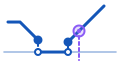

# Balances Equilibrium — `plan-equilib`

[](https://krm-demo.github.io/krm-demo-org-site/swept-amount-math.en.html)
&nbsp;&nbsp;
[](https://krm-demo.org/swept-amount-math.en.html)

*My balances sing romances.* One of them lives paycheck to paycheck: it sighs when it gets too thin and gets
restless when it gets too fat. The other one sits quietly in an investment account and grows. They agreed on a few
rules long ago, and since then money moves between them by itself, with no phone calls about pocket change.

This module draws those rules: the **swept amount per current balance** of a cash sweep. It renders the graph as
one SVG **without JavaScript** and serves it from an AWS Lambda. The interactive version, with handles to drag,
lives on the site: the big icon above opens the preview (staging), the small one opens
[krm-demo.org](https://krm-demo.org/) (the AWS version, after the next release of the site).

- Live, from the Lambda: <https://ww3q3jauycs4gei35n5hr4o4lu0vhidr.lambda-url.us-east-1.on.aws/> (move the mouse over the graph) —
  [thousands](https://ww3q3jauycs4gei35n5hr4o4lu0vhidr.lambda-url.us-east-1.on.aws/?sweptOutMax=30000),
  [millions](https://ww3q3jauycs4gei35n5hr4o4lu0vhidr.lambda-url.us-east-1.on.aws/),
  [swept in zero](https://ww3q3jauycs4gei35n5hr4o4lu0vhidr.lambda-url.us-east-1.on.aws/?sweptInMax=0&sweptOutMax=30000),
  [size S](https://ww3q3jauycs4gei35n5hr4o4lu0vhidr.lambda-url.us-east-1.on.aws/?size=S&thresholdMin=50000&thresholdMax=50000&nominalMin=5000&nominalMax=5000&sweptInMax=20000&sweptOutMax=25000)

## Contents

- [The arrangement](#the-arrangement)
- [The swept amount](#the-swept-amount)
- [How it is drawn](#how-it-is-drawn)
- [Without JavaScript](#without-javascript)
- [The Lambda](#the-lambda)
- [Build and deploy](#build-and-deploy)
- [Files](#files)
- [References](#references)

## The arrangement

The first balance is the current account, a **DDA** (demand deposit account): salary comes in, bills go out.
The second is an **investment account**. A **cash sweep** keeps the DDA balance between two thresholds by moving
money between the two accounts automatically:

| Symbol | Query parameter | Meaning |
|---|---|---|
| *T*<sub>min</sub> | `thresholdMin` | the lowest balance the DDA should keep |
| *T*<sub>max</sub> | `thresholdMax` | the highest balance the DDA should keep; *T*<sub>min</sub> ≤ *T*<sub>max</sub>, just *T* when they are equal |
| *τ*<sub>min</sub> | `nominalMin` | the nominal of a sweep in: the smallest transfer worth making |
| *τ*<sub>max</sub> | `nominalMax` | the nominal of a sweep out |
| *A* | `sweptInMax` | **available**: the balance of the investment account. You cannot bring back more than is there. 0, or at least *τ*<sub>min</sub> |
| *L* | `sweptOutMax` | **limit**: the largest single payment the investment account accepts; at least *τ*<sub>max</sub> |

The names of the query parameters are those of `ThresholdsInfo` in [plans-core](../plans-core), plus the two caps.

Below *T*<sub>min</sub> money comes back from the investment account (**swept in**); above *T*<sub>max</sub> the
excess goes there (**swept out**). The nominals protect against pocket change: a sweep happens only if it moves at
least *τ* (and more than nothing).

## The swept amount

*x* is the current balance of the DDA, *y* the swept amount, both in dollars:

| *y* | where | zone |
|---|---|---|
| *A* | *x* < *T*<sub>min</sub> − *A* | Swept in partial |
| *T*<sub>min</sub> − *x* | *T*<sub>min</sub> − *A* ≤ *x* ≤ *T*<sub>min</sub> − *τ*<sub>min</sub> | Swept in full |
| ∄ ⏚ | *x* ≤ *T*<sub>min</sub> − *τ*<sub>min</sub>, when *A* = 0 | Swept in zero |
| 0 | *T*<sub>min</sub> − *τ*<sub>min</sub> < *x* < *T*<sub>max</sub> + *τ*<sub>max</sub> | In nominal min, In range, In nominal max |
| *x* − *T*<sub>max</sub> | *T*<sub>max</sub> + *τ*<sub>max</sub> ≤ *x* ≤ *T*<sub>max</sub> + *L* | Swept out |
| ∄ ⏚ | *x* > *T*<sub>max</sub> + *L* | Overflow |

- **Swept in partial**: far below *T*<sub>min</sub> the sweep takes all of *A* and the balance is still short.
  **Swept in full**: closer to it, exactly what is missing comes back.
- **The jumps.** Because of the nominals, *y* jumps at *T*<sub>min</sub> − *τ*<sub>min</sub> (from *τ*<sub>min</sub>
  to 0) and at *T*<sub>max</sub> + *τ*<sub>max</sub> (from 0 to *τ*<sub>max</sub>). The point of a jump belongs to
  the sweep: on the graph it is filled on the sweep and open on the zero line, and the dashed vertical between them
  has the colour of the sweep.
- **Terminal failure** (∄, ⏚). In two zones the swept amount does not exist: one sweep cannot restore the balance.
  *Overflow*: the excess is above the limit *L*. *Swept in zero*: a sweep in is needed, but the investment account
  is empty (*A* = 0), so the whole left side turns red. ⏚ is the ground symbol the
  [AuditStatus state charts](../plans-core/docs/audit-status/README.md) use for their failure endings.

| Zone | Colour | |
|---|---|---|
| Swept in zero | red, hatched | terminal failure |
| Swept in partial | brown `#8A5418` | *y* = *A* |
| Swept in full | amber `#BA7517` | *y* = *T*<sub>min</sub> − *x* |
| In nominal min, In range, In nominal max | blue `#378ADD` (the nominal zones lighter) | *y* = 0 |
| Swept out | teal `#1D9E75` | *y* = *x* − *T*<sub>max</sub> |
| Overflow | red `#E24B4A`, hatched | terminal failure |
| the probe | purple `#8B5CF6` | the balance under the mouse |

Thousands, *L* = $30,000:



## How it is drawn

- **Only 0°, 45° and 90°.** Every panel has the same dollars per pixel on both axes, so the slopes of *y* = *T*<sub>min</sub> − *x*
  and *y* = *x* − *T*<sub>max</sub> are exactly 45°. The height of the graph follows from its width and the data.
- **Broken axes.** Real amounts are lopsided: thresholds in thousands or hundreds of thousands, *L* in millions.
  On one scale that is a wok with a very long handle. When *T*<sub>max</sub> + *L* is far to the right, both axes break:
  the "pan" (thresholds, nominals, *A*) stays bottom left, the end of the "handle" (Swept out up to *T*<sub>max</sub> + *L*)
  goes top right, in a scale of its own, still at 45°.
- **The ranges fit the parameters**: a margin around *T*<sub>min</sub> − *A* … *T*<sub>max</sub> + *τ*<sub>max</sub>, and
  around *T*<sub>max</sub> + *L* when it is in the same panel.
- **Sizes** L (760 px), M (560 px), S (380 px). Smaller sizes show fewer labels: S only the thresholds and the caps,
  M also the nominals, L everything. Want to see it all? Look at it on a big screen.
- Dashed lines in a zone's colour show what *would* happen without the caps, the nominals or the limit.
  Every point of interest is projected onto the axes with a thin dotted line.
- The colours of text and axes follow the light or dark mode of the reader (`prefers-color-scheme`).

Millions, *L* = $2,000,000, broken axes:



Swept in zero, *A* = 0:



## Without JavaScript

The site version recomputes the picture on every move of the mouse. Here every picture is computed in advance, so
the number of possible positions must be **finite**:

- **Parameters** are rounded to two significant digits (37,512 → $38,000; 2,340,000 → $2,300,000): at most 90
  values per power of ten (`Sweep.snapped()`).
- **The current balance** is sampled: 12, 24, 48 (default) or 96 **frames**, evenly in pixels over the visible
  x axis, each balance rounded to a step of about 1% of its panel.

One SVG holds the static picture and all frames. A frame is a thin transparent strip around its balance plus,
hidden, the purple probe, the readout line on top and the highlight of its row of the formula. CSS shows only the
frame under the mouse, or the default one (about 30% into Swept out) when the mouse is elsewhere:

```css
.on { pointer-events: none }                      /* only the strips catch the mouse */
.f .on { visibility: hidden }
.f:hover .on { visibility: visible }
.frames:not(:hover) .d .on { visibility: visible } /* the default frame */
```

Hover works where the SVG is a document of its own (the Lambda's answer opened in a browser) or inline in HTML.
As an ``, like the pictures in this README, it is static and shows the default frame.

Since the set of answers is finite, the same frames could also be rendered ahead of time in parallel, one picture
per frame, and swapped by the page; the single-SVG form needs no page at all.

## The Lambda

`GET https://ww3q3jauycs4gei35n5hr4o4lu0vhidr.lambda-url.us-east-1.on.aws/?<parameters>` answers `image/svg+xml`. All parameters are optional; the defaults are the
millions example (*T*<sub>min</sub> $40,000, *T*<sub>max</sub> $60,000, *τ* $8,000 / $10,000, *A* $25,000, *L* $2,000,000).

| Parameter | |
|---|---|
| `thresholdMin`, `thresholdMax`, `nominalMin`, `nominalMax`, `sweptInMax`, `sweptOutMax` | whole dollars; `2,000,000`, `2_000_000` and `$2000000` work too |
| `size` | `L` (default), `M`, `S` |
| `frames` | `12`, `24`, `48` (default), `96`; other numbers go to the nearest |

Inconsistent parameters (*T*<sub>min</sub> > *T*<sub>max</sub>, 0 < *A* < *τ*<sub>min</sub>, *L* < *τ*<sub>max</sub>) answer
`400` with the reason as text. Answers may be cached for a day (`Cache-Control: public, max-age=86400`).

- **Runtime**: Java 21 on arm64, 512 MB, no libraries at all: the Java runtime calls
  `EquilibHandler::handleRequest(InputStream, OutputStream)` with the raw Function URL event, and the 50 KB jar is
  the whole package. A warm call renders in a few milliseconds.
- **Cost**: within the AWS free tier (1 million requests and 400,000 GB-seconds a month) it costs nothing.
- **Security**: none yet: the Function URL is public (`AuthType NONE`). To cap the cost of abuse meanwhile, at most
  5 copies of the function run at a time (reserved concurrency 5); more callers get `429`. Later: a CloudFront distribution in front
  of it (caching, a rate limit with AWS WAF) and an origin access control, or a signed URL for the real application.

## Build and deploy

```bash
mvn -pl plan-equilib -am verify                    # build, tests, regenerate docs/*.svg (commit them)
mvn -pl plan-equilib compile exec:java@docs        # only the pictures
```

- **Deploy**: every push to `main` that touches `plan-equilib/` runs
  [`.github/workflows/plan-equilib.yml`](../.github/workflows/plan-equilib.yml): build, test, check that `docs/` is
  committed, replace the code of the Lambda, smoke-test the URL. It signs in to AWS with OIDC (no stored keys) as
  the role `plan-equilib-deploy`, which trusts only pushes to `main` of this repository and may only update this
  one function.
- **One-time setup** (done for account 560574854768, us-east-1): [`deploy/setup.sh`](deploy/setup.sh) creates the
  execution role, the function, its public URL with both permissions it needs, and the deploy role.

## Files

```
pom.xml                         no runtime dependencies; exec:java@docs writes docs/*.svg
src/main/java/org/krmdemo/plansinstr/equilib/
  Sweep                         the parameters, the swept amount at() a balance, snapping
  Zone                          the zones, their titles and colours, terminal or not
  Layout                        data ranges and pixels, broken axes, 45° everywhere, clipping
  SvgRenderer                   the SVG: zones, function, labels, formula, legend, the frames
  EquilibHandler                the Lambda (Function URL event in, SVG out)
  EquilibDocs                   writes docs/*.svg
src/test/java/…                 SweepTest, SvgRendererTest
docs/                           the pictures of this README and the two icons
deploy/setup.sh                 the one-time AWS setup
```

## References

- [Lambda Function URLs](https://docs.aws.amazon.com/lambda/latest/dg/urls-configuration.html) and their
  [permissions](https://docs.aws.amazon.com/lambda/latest/dg/urls-auth.html)
- [Java handlers without the Lambda library](https://docs.aws.amazon.com/lambda/latest/dg/java-handler.html)
- [GitHub Actions: OpenID Connect in AWS](https://docs.github.com/en/actions/security-for-github-actions/security-hardening-your-deployments/configuring-openid-connect-in-amazon-web-services)
- [Liang–Barsky line clipping](https://en.wikipedia.org/wiki/Liang%E2%80%93Barsky_algorithm)
- The interactive version: [krm-demo-org-site, `site/projects/swept-amount-math/`](https://github.com/krm-demo/krm-demo-org-site/tree/main/site/projects/swept-amount-math)
