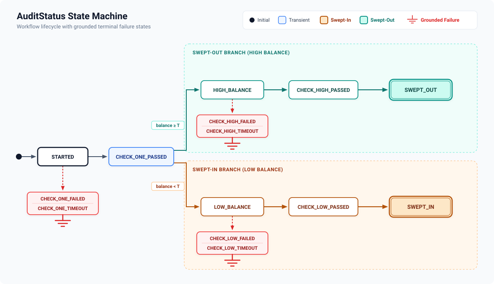
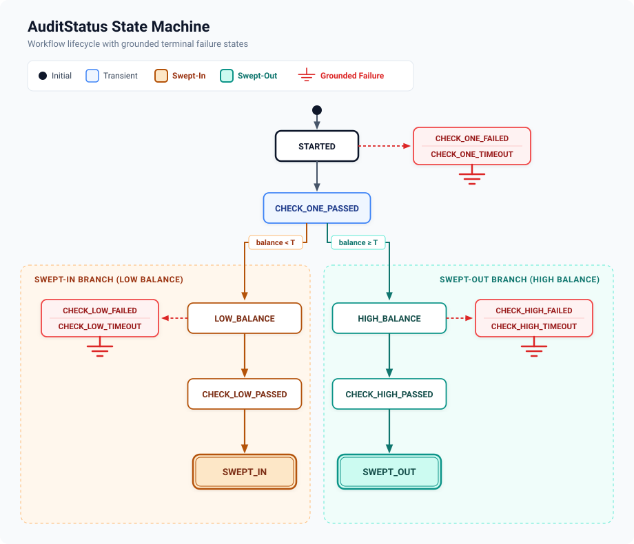

# AuditStatus state machine (proposal)

A state diagram for a balance-driven version of `AuditStatus`. It shows three verification
checkpoints, a split on the balance threshold `T`, and two successful endings: `SWEPT_IN` and
`SWEPT_OUT`.

> **Status:** implemented. `AuditStatus` (plans-core) holds these statuses and their transitions
> (`balance`, `checkPassed`, `swept`, `failure`). In plans-exec the saga runs four stages:
> `PropOneEvent` (check one), `BalanceEvent` (the split, via `BalanceRetriever`), `PropTwoEvent`
> (check low / check high) and `SweepEvent` (`SWEPT_IN` / `SWEPT_OUT`). A retriever timeout
> becomes the checkpoint's `*_TIMEOUT` status. The poller claims every due, unfinished execution,
> so a run that stopped halfway is picked up again after its lease.

## Initial conditions

Statuses:

| status | role |
|---|---|
| `SCHEDULED` | initial |
| `CHECK_ONE_PASSED` | transient |
| `CHECK_ONE_FAILED`, `CHECK_ONE_TIMEOUT` | failure, final |
| `LOW_BALANCE`, `HIGH_BALANCE` | transient |
| `CHECK_LOW_PASSED` | transient |
| `CHECK_LOW_FAILED`, `CHECK_LOW_TIMEOUT` | failure, final |
| `CHECK_HIGH_PASSED` | transient |
| `CHECK_HIGH_FAILED`, `CHECK_HIGH_TIMEOUT` | failure, final |
| `SWEPT_IN`, `SWEPT_OUT` | success, final |

There are three checkpoints where processing can fail and *ground out*:

1. Initial verification: `SCHEDULED` → `CHECK_ONE_FAILED` / `CHECK_ONE_TIMEOUT`
2. Low-balance verification: `LOW_BALANCE` → `CHECK_LOW_FAILED` / `CHECK_LOW_TIMEOUT`
3. High-balance verification: `HIGH_BALANCE` → `CHECK_HIGH_FAILED` / `CHECK_HIGH_TIMEOUT`

Each failure pair is drawn as one stacked box with an electrical ground symbol underneath.

## Transitions

```
SCHEDULED ► CHECK_ONE_PASSED ──┬─ balance < T ─► LOW_BALANCE  ─► CHECK_LOW_PASSED  ─► SWEPT_IN
   │                           │                     │
   ⏚ CHECK_ONE_FAILED/TIMEOUT  │                     ⏚ CHECK_LOW_FAILED/TIMEOUT
                               └─ balance ≥ T ─► HIGH_BALANCE ─► CHECK_HIGH_PASSED ─► SWEPT_OUT
                                                     │
                                                     ⏚ CHECK_HIGH_FAILED/TIMEOUT
```

## Diagrams

Two layouts of the same machine. Pick whichever fits the page around it.

**Horizontal**: flow runs left to right. Swept-Out is the upper lane and Swept-In the lower one.



**Vertical**: flow runs top to bottom. Swept-In is the left lane and Swept-Out the right one.



PNG copies (`audit-status-horizontal.png`, `audit-status-vertical.png`) are next to the SVGs
for places that do not render SVG.

### Notation

| mark | meaning |
|---|---|
| black dot | initial pseudo-state |
| blue box | common transient state (before the balance split) |
| amber / brown | Swept-In branch (`balance < T`) |
| teal | Swept-Out branch (`balance ≥ T`) |
| double border | final success state |
| red dashed arrow + red box + ⏚ | failure: a terminal state with no outgoing transitions |

**Why a ground symbol?** The ground (US) or earth (UK/IEC) symbol ⏚ is three shrinking
horizontal lines under a vertical stem. Anyone who learned basic electricity at school knows it.
In the diagram it means what it means in a circuit: execution drops to zero potential and stays
there. It replaces the UML final-state bullseye ◉ for the failure exits, so the two success
endings and the six failure endings look different at a glance.

## Enum as drawn

```java
package org.krmdemo.plansinstr.core.model.enums;

public enum AuditStatus {

    SCHEDULED(Kind.STAGE),
    CHECK_ONE_PASSED(Kind.STAGE),
    CHECK_ONE_FAILED(Kind.FAILURE),
    CHECK_ONE_TIMEOUT(Kind.FAILURE),

    LOW_BALANCE(Kind.STAGE),
    CHECK_LOW_PASSED(Kind.STAGE),
    CHECK_LOW_FAILED(Kind.FAILURE),
    CHECK_LOW_TIMEOUT(Kind.FAILURE),
    SWEPT_IN(Kind.SUCCESS),

    HIGH_BALANCE(Kind.STAGE),
    CHECK_HIGH_PASSED(Kind.STAGE),
    CHECK_HIGH_FAILED(Kind.FAILURE),
    CHECK_HIGH_TIMEOUT(Kind.FAILURE),
    SWEPT_OUT(Kind.SUCCESS);

    public enum Kind {
        /** Progress inside the saga ("transient" in the diagram). */
        STAGE,
        /** Execution finished successfully. */
        SUCCESS,
        /** Execution failed for good (grounded); the first one sticks. */
        FAILURE
    }

    private final Kind kind;

    AuditStatus(Kind kind) {
        this.kind = kind;
    }

    public Kind kind() {
        return kind;
    }

    public boolean isFailure() {
        return kind == Kind.FAILURE;
    }

    public boolean isFinal() {
        return kind == Kind.SUCCESS || kind == Kind.FAILURE;
    }
}
```

In the current enum, `Kind.TRANSIENT` means "a retriever will be retried". The diagram uses
"transient" for any non-final step, so the sketch above maps those steps to `Kind.STAGE`.
