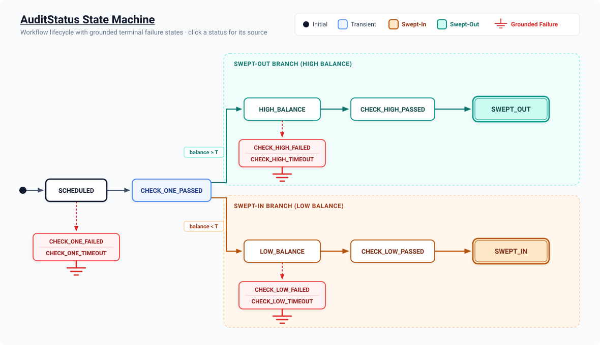
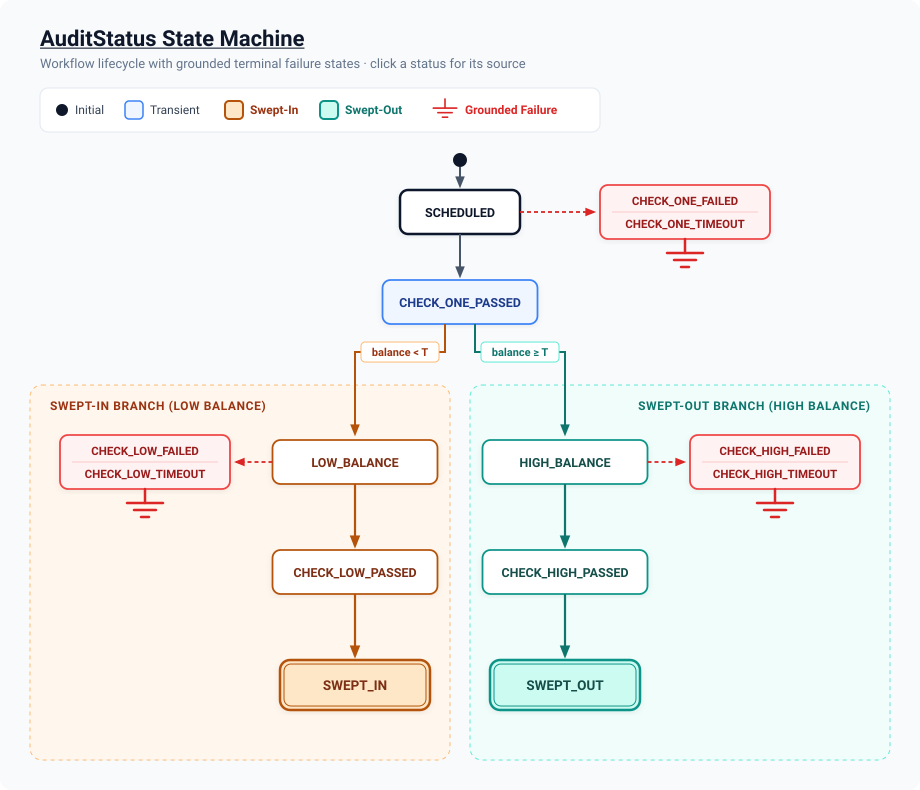

# AuditStatus state machine (proposal)

A state diagram for a balance-driven version of `AuditStatus`. It shows three verification
checkpoints, a split on the balance threshold `T`, and two successful endings: `SWEPT_IN` and
`SWEPT_OUT`.

> **Status:** implemented. `AuditStatus` (plans-core) holds these statuses and their transitions
> (`balance`, `checkPassed`, `swept`, `failure`). In plans-exec the saga runs four stages:
> `PropOneEvent` (check one), `BalanceEvent` (the split, via `BalanceRetriever`), `PropTwoEvent`
> (check low / check high) and `SweepEvent` (`SWEPT_IN` / `SWEPT_OUT`). A retriever timeout
> becomes the checkpoint's `*_TIMEOUT` status. The poller claims every due, unfinished execution,
> so a run that stopped halfway is picked up again after its lease.

## Initial conditions

Statuses:

| status | role |
|---|---|
| `SCHEDULED` | initial |
| `CHECK_ONE_PASSED` | transient |
| `CHECK_ONE_FAILED`, `CHECK_ONE_TIMEOUT` | failure, final |
| `LOW_BALANCE`, `HIGH_BALANCE` | transient |
| `CHECK_LOW_PASSED` | transient |
| `CHECK_LOW_FAILED`, `CHECK_LOW_TIMEOUT` | failure, final |
| `CHECK_HIGH_PASSED` | transient |
| `CHECK_HIGH_FAILED`, `CHECK_HIGH_TIMEOUT` | failure, final |
| `SWEPT_IN`, `SWEPT_OUT` | success, final |

There are three checkpoints where processing can fail and *ground out*:

1. Initial verification: `SCHEDULED` → `CHECK_ONE_FAILED` / `CHECK_ONE_TIMEOUT`
2. Low-balance verification: `LOW_BALANCE` → `CHECK_LOW_FAILED` / `CHECK_LOW_TIMEOUT`
3. High-balance verification: `HIGH_BALANCE` → `CHECK_HIGH_FAILED` / `CHECK_HIGH_TIMEOUT`

Each failure pair is drawn as one stacked box with an electrical ground symbol underneath.

## Transitions

```
SCHEDULED ► CHECK_ONE_PASSED ──┬─ balance < T ─► LOW_BALANCE  ─► CHECK_LOW_PASSED  ─► SWEPT_IN
   │                           │                     │
   ⏚ CHECK_ONE_FAILED/TIMEOUT  │                     ⏚ CHECK_LOW_FAILED/TIMEOUT
                               └─ balance ≥ T ─► HIGH_BALANCE ─► CHECK_HIGH_PASSED ─► SWEPT_OUT
                                                     │
                                                     ⏚ CHECK_HIGH_FAILED/TIMEOUT
```

## Diagrams

Two layouts of the same machine. Pick whichever fits the page around it.

**Horizontal**: flow runs left to right. Swept-Out is the upper lane and Swept-In the lower one.



**Vertical**: flow runs top to bottom. Swept-In is the left lane and Swept-Out the right one.



The SVGs live in the enum's javadoc `doc-files/` folder, so the `@see` links in
`AuditStatus.java` open them from the IDE and from the published javadoc. PNG copies
(`audit-status-horizontal.png`, `audit-status-vertical.png`) are here, for places that do not
render SVG.

### Links between the diagram and the code

- **Diagram → code:** every status box (each half of a failure pair too) links to its javadoc and
  constant in `AuditStatus.java` on GitHub, as a highlighted line range. The title links to the enum itself. Links work
  when the SVG is opened on its own, for example from the javadoc, the IDE or a browser tab.
  GitHub's preview shows SVGs as images, so they are not clickable there.
- **Code → diagram:** the enum's javadoc has `@see` links to both SVGs.

The diagrams are generated during the Maven build. The Thymeleaf templates in
[`plans-core/src/main/statechart/`](../../src/main/statechart/) hold the layout; each status link
there is a `th:href="${hrefs['X']}"`. `StateChartGenerator` (in the test sources, so it does not
ship) reads `AuditStatus.java`, works out each status's lines, and renders the templates into
`doc-files/`. Maven runs it in the `process-test-classes` phase, right before the tests.
To run only the generator (the `state-charts` execution of `exec-maven-plugin`; `test-compile`
first because the generator is in the test sources):

```
mvn -pl plans-core test-compile exec:java@state-charts
```

Commit the regenerated SVGs. CI fails when the committed ones differ from what the build
produces. The PNG previews here are not regenerated; they only change when the layout does.

### Notation

| mark | meaning |
|---|---|
| black dot | initial pseudo-state |
| blue box | common transient state (before the balance split) |
| amber / brown | Swept-In branch (`balance < T`) |
| teal | Swept-Out branch (`balance ≥ T`) |
| double border | final success state |
| red dashed arrow + red box + ⏚ | failure: a terminal state with no outgoing transitions |

**Why a ground symbol?** The ground (US) or earth (UK/IEC) symbol ⏚ is three shrinking
horizontal lines under a vertical stem. Anyone who learned basic electricity at school knows it.
In the diagram it means what it means in a circuit: execution drops to zero potential and stays
there. It replaces the UML final-state bullseye ◉ for the failure exits, so the two success
endings and the six failure endings look different at a glance.

## Enum

The source is [`AuditStatus.java`](../../src/main/java/org/krmdemo/plansinstr/core/model/enums/AuditStatus.java).
Its constants carry no data. Their roles come from three static sets that split all values
exactly (checked when the class loads):

| set | statuses | predicate |
|---|---|---|
| `TRANSIENT_STATUSES` | `SCHEDULED`, `CHECK_ONE_PASSED`, `LOW_BALANCE`, `CHECK_LOW_PASSED`, `HIGH_BALANCE`, `CHECK_HIGH_PASSED` | `isTransient()` |
| `SUCCESS_STATUSES` | `SWEPT_IN`, `SWEPT_OUT` | `isSuccess()` |
| `FAILED_STATUSES` | the six `*_FAILED` / `*_TIMEOUT` | `isFailed()` |
| `FINAL_STATUSES` | success ∪ failed | `isFinal()` |

The transitions are methods too: `balance(…)`, `checkPassed()`, `swept()`, `failure(timeout)`.
